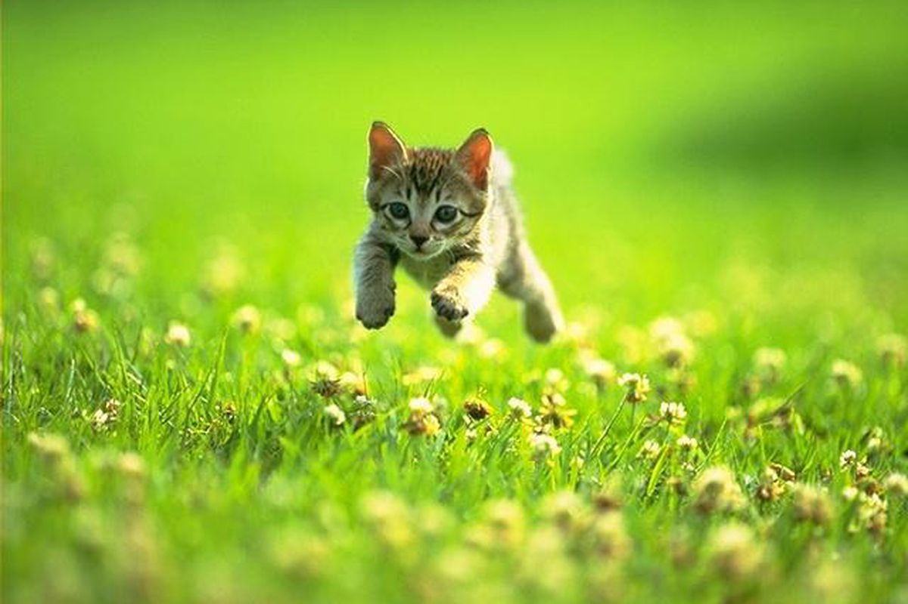

# Procesverslag
Markdown is een simpele manier om HTML te schrijven.  
Markdown cheat cheet: [Hulp bij het schrijven van Markdown](https://github.com/adam-p/markdown-here/wiki/Markdown-Cheatsheet).

Nb. De standaardstructuur en de spartaanse opmaak van de README.md zijn helemaal prima. Het gaat om de inhoud van je procesverslag. Besteedt de tijd voor pracht en praal aan je website.

Nb. Door *open* toe te voegen aan een *details* element kun je deze standaard open zetten. Fijn om dat steeds voor de relevante stuk(ken) te doen.

## Jij

  
uitwerken voor kick-off werkgroep

  ### Auteur:
  Daniël Prins

  #### Je startniveau:
  Blauw

  #### Je focus:
  Responsive

  
Ik ben niet heel goed in coderen en vind het vaak best lastig. Vooral mijn JavaScript is dramatisch. Toch wil ik er graag beter in worden, omdat ik uiteindelijk ook coole animaties en interactieve websites wil kunnen maken. Maar voordat ik daarmee kan beginnen, wil ik eerst goed begrijpen hoe responsiveness werkt. Dat is voor mij de basis. Ik merkte ook dat ik nog wat kennis miste, omdat ik de oefeningen van de tussencursus niet had gedaan. 

Zo wist ik bijvoorbeeld niet dat je bij `display: flex` ook `flex-wrap` moet gebruiken als je wilt dat elementen naar de volgende regel kunnen gaan. Daardoor liepen mijn kaartjes buiten het scherm. Met deze opdracht wil ik daarom vooral mijn basis verbeteren, zodat ik uiteindelijk ook de moeilijkere dingen kan gaan maken.
 

## Je website

  
uitwerken voor kick-off werkgroep

  ### Je opdracht:
 [ link naar de website die je gaat namaken óf de naam/omschrijving van je eigen ontwerp](https://nl.tonyschocolonely.com/)

  #### Screenshot(s) van de eerste pagina (small screen): 
  Home pagina 
  

  De homepage bestaat uit verschillende onderdelen waarin de chocoladeproducten en de missie van Tony's centraal staan. Er is een chocoladecarrousel, informatie over hun missie, zakelijke chocolade en nieuws.
  
  Wat ik interessant vind aan deze pagina, is dat bijna elke sectie anders is opgebouwd. Er wordt veel gespeeld met kleuren, afbeeldingen en de verhouding tussen tekst en beeld. Het goed laten werken van al deze verschillende indelingen op meerdere schermformaten lijkt me pittig, maar wel leerzaam.

  #### Screenshot(s) van de tweede pagina (small screen):
  Tony Chocolonely website 
   
  
  Op deze pagina vertelt Tony's meer over hun missie en hoe ze uitbuiting in de cacao-industrie willen tegengaan. De pagina bestaat uit veel grote afbeeldingen, tekstblokken en onderdelen die je kunt uitklappen.
  
  Deze pagina is interessant omdat er veel verschillende soorten content door elkaar worden gebruikt. De uitdaging zit voor mij vooral in het overzichtelijk houden van de pagina, ook op kleinere schermen.

## Toegankelijkheidstest 1/2 (week 1)

  
uitwerken na test in 2e werkgroep

  ### Bevindingen
  Toetsenbordnavigatie

De toetsenbordnavigatie werkt eigenlijk best goed. Als je met Tab door de website gaat, kun je duidelijk zien waar je bent doordat de focus zichtbaar blijft.

Bij de chocoladecarrousel kom je niet alleen op het plusje terecht om chocolade toe te voegen, maar ook op de tekst van de producten. Bij de rest van de website ga je vooral langs knoppen en links. De navigatie werkt hierdoor anders dan op de rest van de website. Ik weet niet of het fout is, maar het viel me wel op.

Screenreader
Bij het testen met de screenreader merkte ik dat ik vooral door de knoppen kon navigeren. In eerste instantie dacht ik daarom dat de website helemaal geen headings had.

Toen ik de website ging inspecteren, ontdekte ik dat die headings er wel waren. Ze stonden namelijk gewoon als h2 in de HTML. Ik kwam erachter dat ik de screenreader niet helemaal goed gebruikte. Ik navigeerde namelijk met Tab, maar daarmee ga je alleen langs interactieve elementen en niet langs headings. Om tussen de headings te navigeren, moet je de rotor van de screenreader gebruiken. Het probleem lag dus niet bij de website, maar bij de manier waarop ik de screenreader gebruikte.

Wat me ook opviel, is dat de winkelmand door de screenreader werd voorgelezen als 'mn tassie'. Dit past natuurlijk helemaal bij Tony's, maar ik denk dat het voor iemand die de website niet kan zien best verwarrend kan zijn. Je mist namelijk de visuele context. Ik zou daarom voor de screenreader gewoon 'winkelmand' gebruiken, zodat meteen duidelijk is wat ermee bedoeld wordt.

Visuele toegankelijkheid
Bij de visuele toegankelijkheid viel me op dat de zwarte tekst op een rode achtergrond op sommige plekken niet genoeg contrast heeft. Hierdoor is de tekst minder goed leesbaar.  Ik heb dit gecontroleerd met de kleurenpikker in Chrome DevTools en kwam uit op een contrastratio van 4,46:1. Volgens de WCAG moet normale tekst minimaal 4,5:1 hebben. De tekst zit hier dus net onder en voldoet daarmee niet aan de WCAG-richtlijn voor kleurcontrast (1.4.3 Contrast Minimum).

Wat wel goed ging, was het inzoomen naar 200%. De onderdelen gingen bij mij niet door elkaar lopen en alles bleef gewoon leesbaar.

Het laatste puntje, en misschien ook wel het vervelendste, is dat er bij afbeeldingen geen alternatieve tekst aanwezig was. Hierdoor kunnen mensen die de website met een screenreader gebruiken belangrijke informatie missen die alleen via een afbeelding wordt overgebracht.

## Breakdownschets (week 1)

  
uitwerken na afloop 3e werkgroep

  ### de hele pagina: 
  

  ### dynamisch deel (bijv menu): 
  

  ### wellicht nog een dynamisch deel (bijv filter): 
  

## Voortgang 1 (week 2)

  
uitwerken voor 1e voortgang

  ### Stand van zaken
  Je breakdownschetsen gemaakt en Tony’s gekozen, met responsive als focus
  Een voortgangsgesprek gehad. Ik vroeg me toen af hoe ik de verschillende secties het beste responsive kon maken en wanneer Grid handiger is dan flexbox?
  Ik had de homepage opgebouwd, mobile-first: header met nav, hero, producten, onze belofte, nieuwtjes, nog geen tijd gehad voor de footer

## Voortgang 2 (week 3)

  
uitwerken voor 2e voortgang

  ### Stand van zaken
  Ik was begonnen aan de footer, maar dat was echt enorm veel werk. Het waren namelijk heel veel linkjes. Dat zorgde voor sorot priegelwerk om het linkje voor linkje over te zetten, maar dat is gelukkig gelukt. Toen de hele site was afgebouwd ging ik m responsive maken en had ik een dark mode toegevoegd. Ik ging kijken of ik al een beetje met javascript aan de slag kon voor de grappengenerator, maar dat werd me niet in dank afgenomen. Dat ging echt vreselijk en ik kon helaas ook niet naar de voortgang gesprekken komen, dus dat was even een domper.

## Toegankelijkheidstest 2/2 (week 4)

  
uitwerken na test in 9e werkgroep

  ### Bevindingen
  Lijst met je bevindingen die in de test naar voren kwamen (geef ook aan wat er verbeterd is):

## Voortgang 3 (week 4)

  
uitwerken voor 3e voortgang

  ### Stand van zaken
  Ik ging deze afgelopen weken als een speer. Ik heb pagina 2 af en responsive gemaakt. Er zijn nog wat kinderziektes in de grootte van de afbeelding die ik eruit probeer te krijgen, maar dat is me nog niet gelukt. Ik heb voor nu eerst even de nadruk gelegd op de toegankelijkheid aangezien dat belangrijker is dan of het plaatje even overeen komt met het plaatje op de echte site. Ik ben bij de tweede pagina vooral bezig geweest met het hoe kan ik de pagina responsive maken voor de telefoon en laptop aangezien het veel tekst was. Ik had daarbij het grote voorbeeld van de webiste zelf een beetje achterwege gelaten. 

## Eindgesprek (week 5)

  
uitwerken voor eindgesprek

  ### Je uitkomst - karakteristiek screenshots:
  

  ### Dit ging goed/Heb ik geleerd: 
Ik ben heel blij met de homepagina. Hij lijkt enorm op de echte site en er zijn veel verschillende secties die goed zijn nagemaakt. En responsive ook. Ik heb veel geleerd over toegankelijkheid en het dus ook zoveel mogelijk toegepast zodat deze pagina beter werkt dan de originele.

  

  ### Dit was lastig/Is niet gelukt:
  De website 1/1 te laten lijken. Ik heb uiteindelijk meer gefocused op de toegankelijkheid en leesbaarheid dan echt op de aesthetiek. De lettertypes zijn niet top gelukt. Ook vind ik het jammer dat ik nogsteeds niet alles zonder echt op te zoeken uit mn hoofd de verschillende elementen kent. Het is veel zoekwerk geweest. Javascript vond ik ook heel moeilijk. Ik heb daar nooit echt een knobbel voor gehad, maar het is gelukt en daar ben ik wel heel trots op

  

## Bronnenlijst

  
continu bijhouden terwijl je werkt

  1. MDN — onder andere de pagina over light-dark()
  2. Internet Archive / Wayback Machine — de versie van nl.tonyschocolonely.com van 4 juli 2026
  3. Google Fonts — Alfa Slab One en Roboto Slab
  4. De A11y Project checklist — voor de toegankelijkheidstests

